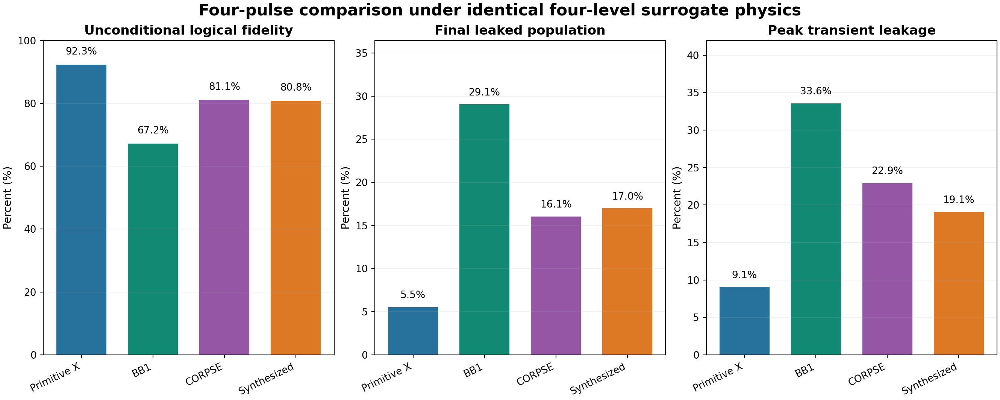
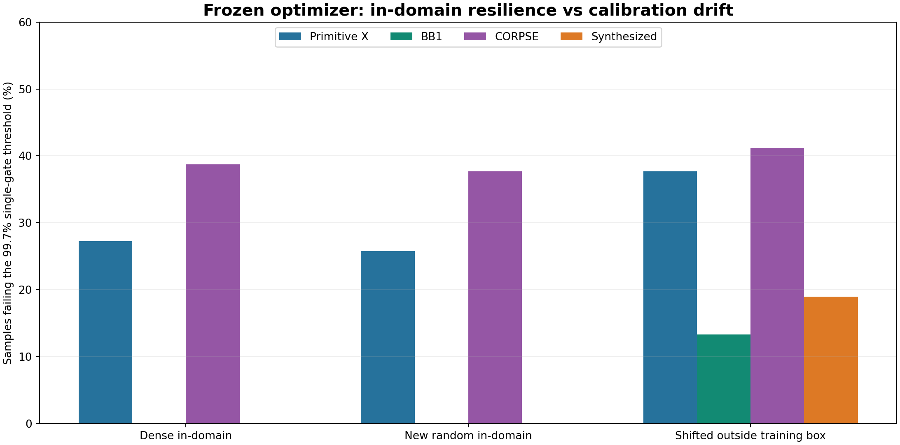

# PulseWise — Quantum Control Lab

**Team Semiclassical · Qompute 2026 · Track 3: Can We Trust a Noisy Quantum Computer?**

**A faster quantum gate is not necessarily a more reliable quantum computation.**

PulseWise is a research-focused, interactive Python/Qiskit demonstration of how quantum-control choices trade off **single-gate fidelity, circuit-level correctness, pulse duration, robustness, and leakage**. It compares standard X, BB1, and CORPSE controls; searches for new five-segment controls; and challenges its own optimizer using longer circuits and an intentionally separate multilevel model.

All numerical findings below are **simulations, not quantum-hardware measurements**.

## Explore the project

- **[Technical architecture and research workflow](docs/ARCHITECTURE.md)** — GitHub-rendered, source-editable diagrams of the selector, optimizer, benchmarking, Qiskit checks, and model boundaries.
- **[Figure guide](docs/FIGURE_GUIDE.md)** — complete walkthrough of the research plots, their axes/meaning, and presentation cautions.
- **[Scientific references and Gridium attribution](REFERENCES.md)** — peer-reviewed pulse/control references, the public Gridium thesis and code repository, and clear distinctions between inspiration and implementation.
- **[Third-party software notices](THIRD_PARTY_NOTICES.md)** — declared dependencies and license links. The team's own source has not yet been assigned a top-level license.

## Why this matters

A control technique that suppresses one error may take longer, amplifying decoherence or responding poorly to different imperfections. High average fidelity of a single gate is not a guarantee of correct answers after many gates. Our goal is a *transparent decision aid* that shows both benefits and failure cases instead of reporting a single optimistic fidelity number.

## Main findings

### 1. Shorter single-gate pulse — with an important limit

With a fixed modeled drive rate and a sampled 99.7% gate-fidelity requirement, constrained synthesis yielded a **345.68 ns** five-segment candidate, compared with **500 ns** for BB1 (**30.9% shorter**). The optimized candidate's worst training-sample fidelity was approximately **99.7027%**—only narrowly above the threshold. This is a local, sample-constrained result, **not** a claim of global time optimality or hardware speedup.

### 2. A strong single-gate candidate can fail at circuit depth

Under a frozen **+5% amplitude error, +0.04 normalized detuning**, and the saved T₁/T₂ assumptions, we simulated **32 successive X gates**, which ideally implement the identity on `|0⟩`:

| Pulse | Correct output after X^32 | Total modeled control time | Control segments |
| --- | ---: | ---: | ---: |
| Primitive X | 68.73% | 3.20 µs | 32 |
| BB1 | **95.57%** | 16.00 µs | 128 |
| CORPSE | 64.64% | 13.87 µs | 96 |
| Synthesized | **4.32%** | 11.06 µs | 160 |

The synthesized pulse was optimized for **sampled single-gate fidelity**, not long-circuit success. This is a counterexample within one specified simulation regime, not a universal ranking. Coherent errors can accumulate non-monotonically, so circuit depth matters.


### 3. Multilevel leakage can change the winner

We then evaluated the **same four waveforms** in an independent **coherent four-level surrogate** with identical drive and coupling assumptions (`α/Ω = −3`, `η = √2`, zero applied bias):

| Pulse | Logical fidelity | Final leakage |
| --- | ---: | ---: |
| Primitive X | **92.32%** | 5.55% |
| BB1 | 67.24% | 29.06% |
| CORPSE | 81.09% | 16.06% |
| Synthesized | 80.75% | 17.01% |

The surrogate has a computational subspace, an unwanted leakage level, and a spectator. It **does not include T₁/T₂** and **is not a calibrated Gridium Hamiltonian**. Do **not** directly compare its absolute fidelity values to the noisy two-level circuit above. It tests sensitivity to a modeling assumption, not real-device performance.



### 4. Robustness has a domain

The synthesized pulse passes a dense sample check **within** the training uncertainty bounds (worst fidelity approximately **99.7027%**), but **18.9%** of samples in a deliberately shifted *out-of-domain* calibration box miss the 99.7% requirement. Sample tests can reveal failures; they cannot certify every point in a continuous region.



## Explore the interactive demo

| Page | What it demonstrates |
| --- | --- |
| **Control Lab** (`app.py`) | Live noise and coherence controls, three standard pulse choices, fidelity-versus-duration decision, optional six-state Aer check. |
| **Research Lab** (`pages/2_Research_Lab.py`) | Five-segment control synthesis, sampled uncertainty constraints, waveform visualization, four-level leakage exploration, Qiskit model checks. |
| **Reliability Benchmarks** (`pages/3_Reliability_Benchmarks.py`) | Known-answer X^32 circuits, resource accounting, matched multilevel pulse comparison, optimizer stress tests, and 45 Aer circuit checks. |

For a short judge demo: start with a **Control Lab** decision, reveal the **Research Lab** synthesized control, then open **Reliability Benchmarks** to show where that recommendation fails.

## Install and run

Use a Python environment compatible with Qiskit, Qiskit Aer, NumPy, SciPy, Matplotlib, Pandas, Plotly, and Streamlit. The project was validated on **Python 3.13.9, Qiskit 2.4.0, and Qiskit Aer 0.17.2** on macOS; `requirements-research.txt` installs the repository's declared dependencies.

```bash
# From the cloned repository root
python -m pip install -r requirements-research.txt
python -m unittest discover -s tests -p "test_*.py" -v
python -m streamlit run app.py
```

The sidebar will show all three app pages. No IBM account or external quantum hardware is required.

### Reproduce the numerical research results

```bash
# Rebuild the synthesis figures and saved research report
python src/plot_research.py --quick

# Rebuild the circuit, multilevel, and stress-test results
python src/build_option_b.py

# Additionally execute 45 explicit Qiskit Aer circuits, including X^32
python src/build_option_b.py --qiskit
```

Outputs appear in `results/research/` and `results/option_b/`. The builder uses the frozen `results/research/optimization_report.json` control candidate for the Option B study; it does not retrain the optimizer. The Qiskit job uses **2,048 shots per circuit** by default. The 45 circuits comprise five candidates (including ideal) times one identity circuit and eight parity-input circuits.

The Aer circuits are constructed from the **same modeled quantum channels** as the mathematical predictions. Matching shot statistics is a **code/execution consistency check**, not an independent test of the physical noise assumptions.

## Methods and limitations

- **Two-level controls:** Piecewise rectangular, phase-controlled X rotations evaluated with Markovian Lindblad T₁/T₂ noise, amplitude errors, and detuning. Total composite-pulse duration is counted.
- **Optimizer:** Classical SciPy differential evolution exploration plus BB1-seeded **SLSQP constrained local optimization** of five segment angles and phases. A small training uncertainty set is separated from held-out samples. No proof of globally optimal duration is claimed.
- **Known-answer experiment:** Repeated modeled noisy X channels implement X^N; even N should return `|0⟩` to `|0⟩`. Calibration offsets are held fixed across each circuit.
- **Parity example:** Three-bit parity with noise on selected X input preparations, but **ideal CNOT, initialization, and readout**. It is a limited circuit demonstration, not a full noise benchmark of an algorithm on hardware.
- **Multilevel test:** A coherent pedagogical four-dimensional surrogate; no calibrated superconducting-device Hamiltonian and no claim of a validated Gridium gate.
- **Hardware boundary:** We do not create hardware-executable IBM pulse schedules, characterize a physical processor, demonstrate error correction, or measure gate performance on a real QPU. Our techniques explore **error suppression** and model-aware pulse selection.

The multilevel analysis is **Gridium-inspired** in the sense of borrowing broader ideas from superconducting-qubit control and leakage-aware modeling. It does **not** reproduce Gridium's four-mode Hamiltonian or claim its numerical results. Inspiration from external research and direct use of source code must be distinguished when presenting the project.

## Impact and responsible reporting

Quantum-computing access, execution time, and calibration resources are limited. Treating a simulated single-gate fidelity as a hardware guarantee can waste time and mislead downstream analyses. PulseWise illustrates the value of **reporting operating conditions, resource costs, model mismatch, and negative results**, alongside any apparent speedup.

## Repository map

- `src/` — pulse dynamics, decoherence, selection, synthesis, leakage, Aer checks, and result generators.
- `tests/` — numerical, physics, Qiskit, and regression tests.
- `pages/` — Research Lab and Reliability Benchmarks Streamlit pages.
- `results/selector/`, `results/research/`, `results/option_b/` — reproducible figures, tabular exports, and experiment metadata.
- [`README_RESEARCH.md`](README_RESEARCH.md) — synthesis and surrogate model details.
- [`docs/ARCHITECTURE.md`](docs/ARCHITECTURE.md) — implementation/experimental workflow diagrams.
- [`docs/FIGURE_GUIDE.md`](docs/FIGURE_GUIDE.md) — figure-by-figure explanation and presentation guidance.
- [`REFERENCES.md`](REFERENCES.md) — scientific literature and Gridium provenance.
- [`THIRD_PARTY_NOTICES.md`](THIRD_PARTY_NOTICES.md) — dependency licenses and usage notices.
- [`docs/OPTION_B_INTEGRATION.md`](docs/OPTION_B_INTEGRATION.md) — benchmark definitions and scientific handoff.
- [`results/option_b/NUMERICAL_FINDINGS.md`](results/option_b/NUMERICAL_FINDINGS.md) — precise frozen benchmark metrics.

**Team Semiclassical — Qompute 2026.** See the Git history and pull requests for implementation provenance and individual contributions.
