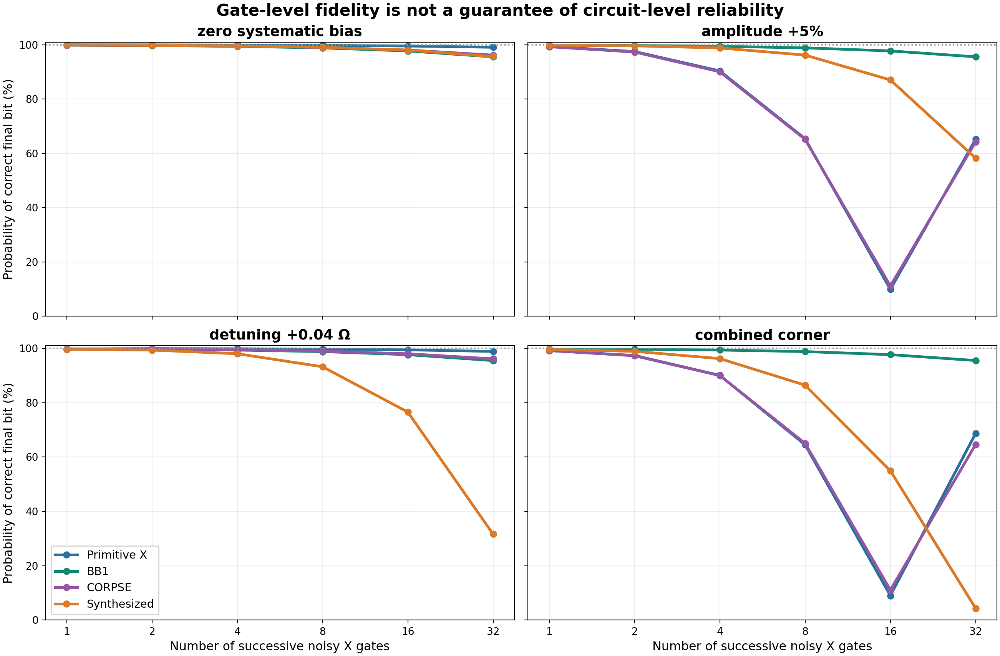

# PulseWise — Quantum Control Lab

Team Semiclassical · Qompute 2026 · Track 3: Can We Trust a Noisy Quantum Computer?

We simulated how pulse design changes the reliability and cost of simple quantum computations. PulseWise combines Python/Qiskit channel models, a pulse selector, sample-constrained synthesis, and a three-page Streamlit dashboard. All reported results are simulations with illustrative parameters, not measured hardware performance.

## A circuit result and its cost

For a fixed 32-X circuit, BB1 increased correct-output probability from **68.73% to 95.57%**, a **26.84-percentage-point** increase, while increasing modeled control duration from **3.20 to 16.00 µs** and executed pulse segments from **32 to 128**. That is five times the duration and four times the segments. These costs describe modeled control, not simulator wall-clock runtime, energy use, cloud charges, or hardware throughput.



The figure starts in the ground state. Odd depths target the excited state; even depths target the ground state. Its panels use fixed amplitude/detuning biases with T1 = 200 µs, T2 = 150 µs and nominal primitive-X duration 100 ns. The lower-right panel combines +5% amplitude error with normalized detuning δ/Ω = +0.04. The table below reports that panel at depth 32, where the ideal operation is identity.

| Pulse | Correct-output probability after 32 X gates | Modeled duration | Executed segments |
| --- | ---: | ---: | ---: |
| Primitive X | 68.73% | 3.20 µs | 32 |
| BB1 | 95.57% | 16.00 µs | 128 |
| CORPSE | 64.64% | 13.87 µs | 96 |
| Synthesized | 4.32% | 11.06 µs | 160 |

[Committed circuit data](results/option_b/known_answer_circuit.csv), [configuration and summary](results/option_b/research_summary.json), and [methodology](docs/OPTION_B_INTEGRATION.md) support this comparison. Fixed coherent errors can accumulate under repeated channel composition; the non-monotonic depth curves are consistent with that interpretation. These data do not isolate a unique mechanism from all other modeled effects. They show that single-gate average fidelity does not determine the result of a particular long circuit.

## Models, selector, and synthesis

Primitive X is one rectangular rotation. BB1 uses four segments to compensate amplitude error; CORPSE uses three segments to compensate detuning. The complete sequence APIs currently target X gates. Every comparison uses a shared nominal drive Ω = π/(100 ns), unless another primitive duration is explicitly specified. Actual sequence durations are 100 ns, 500 ns and approximately 433.33 ns, respectively. Composite sequences do not share the primitive's total duration.

Fractional amplitude error ε scales the drive by 1 + ε. Absolute detuning δ is expressed in rad/ns; normalized detuning is δ/Ω. Thus +0.04 normalized detuning here is approximately +0.00125664 rad/ns. The [two-level model](src/decoherence.py) applies Markovian T1 relaxation and T2 decoherence during every segment, with pure dephasing separated from relaxation and T2 ≤ 2T1. The output is a Qiskit SuperOp, and average gate fidelity compares the complete channel with ideal X, averaged over input states.

The [crossover analysis](results/decoherence/exploration/crossover_baseline/) compares control-error suppression against added decoherence and checks crossings at two grid resolutions. Its baseline T1/T2 is **30/20 µs**, distinct from the **200/150 µs** synthesis and fixed-circuit configuration. [Analysis notes](results/decoherence/exploration/crossover_baseline/analysis_notes.md) describe the conditions and numerical checks. Sweeps that fix absolute detuning while changing drive strength also change δ/Ω.

The standard [selector](src/select_pulse.py) evaluates primitive X, BB1 and CORPSE, then chooses the shortest candidate meeting the requested average-fidelity threshold. It reports no feasible candidate when none qualifies. It does not select the separately synthesized waveform, and its objective is not maximum long-circuit return probability.

For synthesis, we varied five segment angles and phases at fixed drive strength. The uncertainty domain was ε ∈ [−0.05, +0.05] and δ/Ω ∈ [−0.04, +0.04], with a 99.7% sampled fidelity threshold and T1/T2 = 200/150 µs. The [frozen report](results/research/optimization_report.json) records a **345.6786 ns** candidate: **30.8643% shorter** than 500 ns BB1, with worst training fidelity **99.702669%**.

Nine training points enter the optimization. Another 96 points participate in candidate selection; despite historical `heldout_*` field names, these are selection-validation samples, not an untouched final test set. Subsequent frozen-candidate checks use a 961-point dense grid and 512 new random in-domain points. The dense-grid minimum is 99.702669%. In a separate shifted box, **97 of 512 samples (18.9453%)** miss the threshold. [Stress-test data](results/option_b/optimizer_stress_test.csv) and [synthesis implementation](src/research_synthesis.py) distinguish these stages. Finite sampling cannot certify an entire continuous region, and the historical report lacks solver-termination metadata. No global optimum is established.

## Randomized X/identity survival

The [corrected study](docs/PULSEWISE.md#randomized-xidentity-survival-analysis) asks a separate, state-specific question. We sample 32 slots, choosing X independently with probability 1/2; identity is a zero-time no-op. A noisy recovery X is appended when the ideal X count is odd. If k X gates were sampled, the executed count is k + (k mod 2), whose ensemble expectation is 16.5. This restricted randomization samples repetition counts, not general Clifford sequences or gate-order effects.

The following amplitude-only comparison uses +5% amplitude error, **zero absolute detuning**, T1/T2 = **30/20 µs**, nominal primitive duration 100 ns, seed 2026 and 512 matched sequences starting in the ground state. Each family uses its own fixed noisy X channel throughout.

| Pulse | Single-gate average fidelity | Mean ground-state return ± one sequence SE | Sampled mean duration |
| --- | ---: | ---: | ---: |
| Primitive X | 99.3696% | 0.140028 ± 0.005139 | 1.655469 µs |
| BB1 | 98.9012% | 0.855723 ± 0.000951 | 8.277344 µs |
| CORPSE | 98.6433% | 0.217286 ± 0.003871 | 7.173698 µs |

[Comparison CSV](results/rb/survival_study/selector_comparison.csv), [raw samples](results/rb/survival_study/samples.csv), and [metadata](results/rb/survival_study/metadata.json) record the conditions and checksums. Standard errors quantify sequence sampling, not measurement shots. Exact binomial means provide a reference independent of the finite sample. Individual durations vary; the table reports ensemble sample means, not a matched-time experiment.

Primitive is the shortest qualifying choice at a 99% single-gate threshold, while BB1 has the highest return probability in this protocol. Those different objectives do not contradict each other. The other saved survival curves and excited-state control use **mixed errors**, including δ = 0.003 rad/ns; they do not directly test every amplitude-only configuration. Relaxation can favor ground-state return without establishing high gate quality. Historical fitted proxies remain archived, but standard-RB error-rate and approximately 200× improvement interpretations are withdrawn. See the [current results](results/rb/survival_study/) and detailed correction above.

## Separate coherent multilevel check

We applied the same frozen waveforms to a four-level surrogate with α/Ω = −3, coupling ratio η = √2, zero amplitude/detuning bias and Ω = π/(100 ns). This model has no T1/T2. Its unconditional logical fidelity averages overlap with ideal X over logical inputs and counts leakage as failure; it does not renormalize after projecting onto the computational subspace.

| Pulse | Unconditional logical fidelity | Final leakage |
| --- | ---: | ---: |
| Primitive X | 92.32% | 5.55% |
| BB1 | 67.24% | 29.06% |
| CORPSE | 81.09% | 16.06% |
| Synthesized | 80.78% | 16.99% |

[Multilevel CSV](results/option_b/multilevel_comparison.csv) and [observable definitions](src/research_leakage.py) support these values. Final leakage averages the two logical basis inputs. The separately reported peak is a sampled maximum at 18 steps per segment, not a continuous-time bound. These coherent surrogate values cannot be directly compared with decohering two-level fidelities. Gridium-inspired motivation does not make this a calibrated Gridium Hamiltonian; see [references and attribution](REFERENCES.md).

## Navigate the evidence and dashboard

| Component | Source and evidence |
| --- | --- |
| Pulse and decoherence models | [pulses.py](src/pulses.py), [decoherence.py](src/decoherence.py), [tests](tests/) |
| Crossover and selector | [crossover results](results/decoherence/exploration/crossover_baseline/), [selector results](results/selector/) |
| Synthesis and waveform | [research guide](README_RESEARCH.md), [frozen report](results/research/optimization_report.json) |
| Circuit and leakage checks | [integration guide](docs/OPTION_B_INTEGRATION.md), [numerical findings](results/option_b/NUMERICAL_FINDINGS.md) |
| Restricted randomized study | [protocol](docs/PULSEWISE.md#randomized-xidentity-survival-analysis), [results](results/rb/survival_study/) |
| Architecture and figures | [workflow](docs/ARCHITECTURE.md), [figure guide](docs/FIGURE_GUIDE.md) |

Control Lab (`app.py`) selects among the three standard pulses. Research Lab explores synthesis and multilevel behavior. Reliability Benchmarks displays circuit and stress checks. Demonstrate them in that order to distinguish a selector decision from a limitation of the separate synthesis objective. Saved results are checked against waveform/configuration provenance before display. Historical research figures may retain “held-out” terminology; interpret it as candidate-selection validation, not independent final testing.

## Setup and safe reproduction

Run these commands in your own chosen parent directory. A new environment avoids altering an existing installation. Requirements are not pinned; recorded environments are tested configurations, not compatibility guarantees. This documentation audit ran on Windows with Python 3.14.7, Qiskit 2.5.2 and Aer 0.17.2. No IBM account is required for the local dashboard.

PowerShell first-time setup:

```powershell
git clone https://github.com/zaminty13/Qompute-2026-Semiclassical.git
Set-Location Qompute-2026-Semiclassical
py -m venv .venv
.\.venv\Scripts\python.exe -m pip install -r requirements-research.txt
.\.venv\Scripts\python.exe -B -m unittest discover -s tests -p 'test_*.py' -v
.\.venv\Scripts\python.exe -m streamlit run app.py
```

POSIX first-time setup:

```bash
git clone https://github.com/zaminty13/Qompute-2026-Semiclassical.git
cd Qompute-2026-Semiclassical
python3 -m venv .venv
.venv/bin/python -m pip install -r requirements-research.txt
.venv/bin/python -B -m unittest discover -s tests -p 'test_*.py' -v
.venv/bin/python -m streamlit run app.py
```

In an already configured environment, inspect committed results or launch Streamlit directly. The full suite checks frozen-candidate behavior and provenance without retraining or replacing published results. Dashboard controls can request new computations; inspecting its saved results does not require optimization.

To reproduce survival outputs safely, run from the repository root with that environment's Python. These PowerShell commands use new temporary destinations; both scripts refuse to overwrite existing destinations.

```powershell
$studyOutput = Join-Path $env:TEMP ('pulsewise-survival-' + [guid]::NewGuid())
.\.venv\Scripts\python.exe -B src/plot_rb.py --seed 2026 --trials 512 --output $studyOutput
$comparisonOutput = Join-Path $env:TEMP ('pulsewise-comparison-' + [guid]::NewGuid() + '.csv')
.\.venv\Scripts\python.exe -B src/compare_rb_selector.py --seed 2026 --trials 512 --output $comparisonOutput
```

The following generators write fixed repository paths. Run them only in a disposable checkout or copy, using its configured Python:

```text
python src/plot_research.py --quick
python src/build_option_b.py
python src/build_option_b.py --qiskit
```

`plot_research.py --quick` reruns optimization with a reduced budget and overwrites `results/research/optimization_report.json`; it does not guarantee reproduction of the frozen candidate. `build_option_b.py` consumes that report and writes `results/option_b/`; it has no output-directory option. Running optimization first can invalidate comparisons with frozen outputs. The optional `--qiskit` run executes 45 Aer circuits with 2,048 shots each by default. Agreement checks channel execution and sampling, not the truth of the physical noise model. Parity circuits use ideal CNOTs, initialization and readout.

## Scope, impact, and Track 3

Students and small research teams can use these comparisons to ask whether added pulse complexity is justified before spending scarce device access on a candidate. Reporting duration, segment count and failures makes the tradeoff inspectable. A shorter modeled waveform alone does not demonstrate lower cloud costs or energy consumption.

Access to calibrated hardware and specialist control knowledge remains uneven. Simulation can lower the entry cost of exploring hypotheses, while an uncalibrated model can also give false confidence. Before hardware use, the team would need measured noise and drift, bandwidth and drive constraints, realistic leakage characterization, and validation on the intended processor. There are no hardware-executable pulse schedules or error-correction claims here.

The [official Track 3 challenge](https://github.com/sandraalhames/Qompute-2026#your-challenge-make-a-quantum-result-more-trustworthy) maps to the project as follows:

| Track 3 requirement | Implemented evidence |
| --- | --- |
| Experiment with a known answer | [X-depth and parity tests](src/option_b_benchmarks.py) |
| Ideal and noisy baselines | [circuit data](results/option_b/known_answer_circuit.csv), [Aer checks](results/option_b/qiskit_aer_validation.json) |
| Error-handling strategy | [composite controls](src/pulses.py), [sample-constrained synthesis](src/research_synthesis.py) |
| Improvement, cost and implications | Circuit table above, [stress checks](results/option_b/optimizer_stress_test.csv), model limitations |

The challenge does not mandate standard Clifford RB. Technical evidence does not complete the submission: the [official instructions](https://github.com/sandraalhames/Qompute-2026#submission-details-and-challenges) also require a 5–10-minute video and repository submission. No presentation link is supplied here. See [third-party notices](THIRD_PARTY_NOTICES.md) and Git history for software attribution and contributions; public visibility does not assign a license to the team's source.
