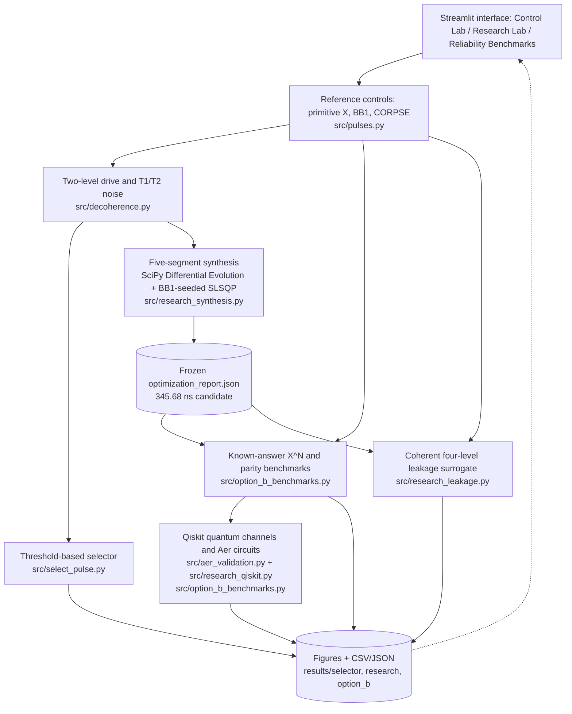
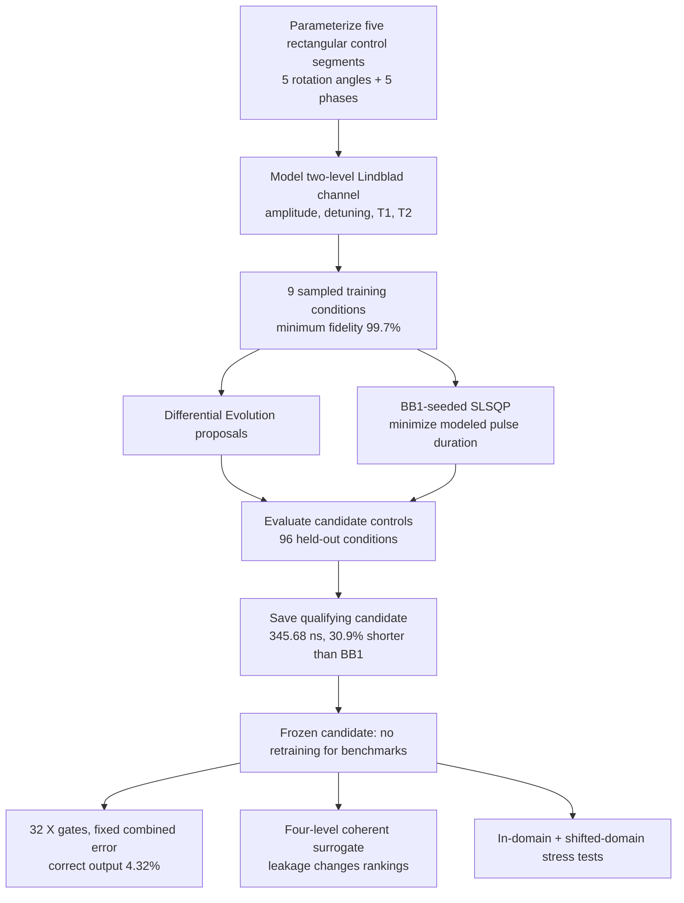
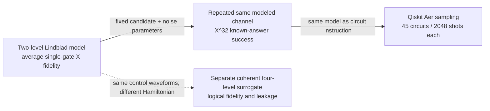

# PulseWise technical architecture

**Team Semiclassical | Qompute 2026, Track 3**

These GitHub-rendered Mermaid diagrams describe the code as implemented on the validated `main` baseline (`67769f7`). They are explanatory diagrams, **not a hardware schematic**. See [figures](FIGURE_GUIDE.md), [references](../REFERENCES.md), and [scientific findings](../results/option_b/NUMERICAL_FINDINGS.md).

## 1. Software and data flow

**Where the tools fit:** NumPy/SciPy perform classical matrix propagation and optimization. Qiskit represents quantum operators and channels, computes reference fidelity metrics, constructs measurement circuits, and executes those circuits with Qiskit Aer. The Aer checks reuse the **same modeled channels**; they verify implementation consistency, not an independently calibrated hardware noise model.

## 2. Optimization and evaluation: the questions are different

The held-out points are excluded from numerical optimization, **but are consulted when choosing the reported candidate**; they should not be presented as a wholly untouched final-test set. The separate dense/shifted stress tests supply additional checks. No continuous-domain certificate or global time optimum is claimed.

## 3. Boundaries between evidence types

**Interpretation:**
- `99.7027%` is the synthesized pulse's *worst sampled average single-gate fidelity* in the specified uncertainty box—not a 32-gate success rate.
- `4.32%` is the synthesized pulse's *correct-output probability* for the 32-gate circuit at the specified combined-error corner; BB1 gives `95.57%` there.
- Four-level surrogate fidelities cannot be directly compared numerically with decohering two-level results: the surrogate has different dynamics and omits T1/T2.
- No IBM hardware experiments, experimentally calibrated pulse schedules, or real-device performance guarantees are reported.

## 4. Where to inspect the evidence

| Question | Primary implementation | Archived evidence |
|---|---|---|
| Which standard pulse qualifies? | [`src/select_pulse.py`](../src/select_pulse.py) | [Selector figures](../results/selector/) |
| How was a pulse synthesized? | [`src/research_synthesis.py`](../src/research_synthesis.py) | [Optimizer report](../results/research/optimization_report.json), [waveform](../results/research/synthesized_waveform.png) |
| Does single-gate optimization survive a long circuit? | [`src/option_b_benchmarks.py`](../src/option_b_benchmarks.py) | [Depth plot](../results/option_b/01_known_answer_depth.png) |
| Does model mismatch matter? | [`src/research_leakage.py`](../src/research_leakage.py) | [Multilevel plot](../results/option_b/02_matched_multilevel.png) |
| Are the Aer circuits consistent with the modeled channels? | [`src/option_b_benchmarks.py`](../src/option_b_benchmarks.py) | [Aer validation JSON](../results/option_b/qiskit_aer_validation.json) |
| Are results covered by regression tests? | [`tests/`](../tests/) | `python -m unittest discover -s tests -p "test_*.py" -v` |

All diagrams are source-editable Mermaid and render directly on GitHub.
