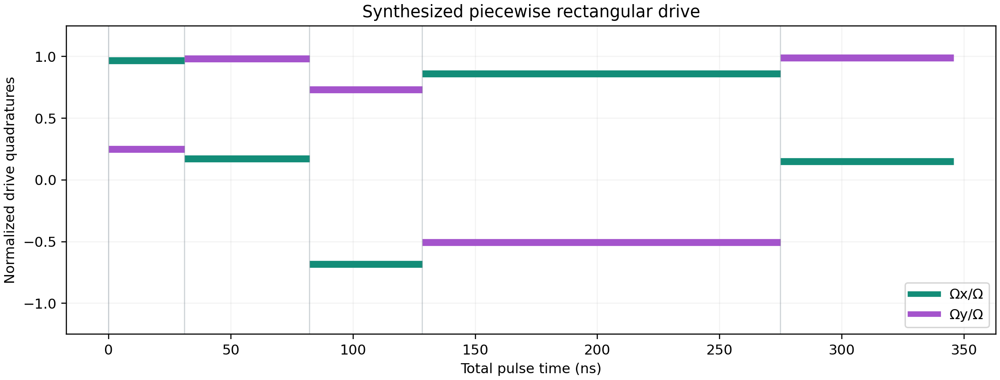
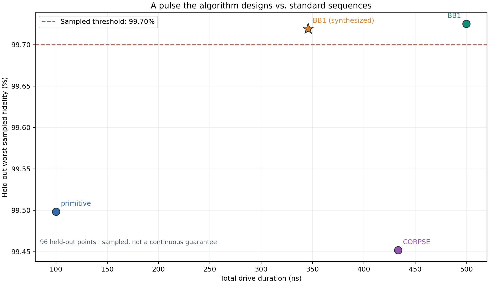
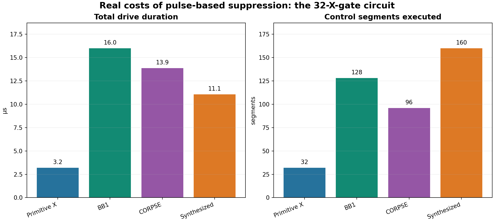
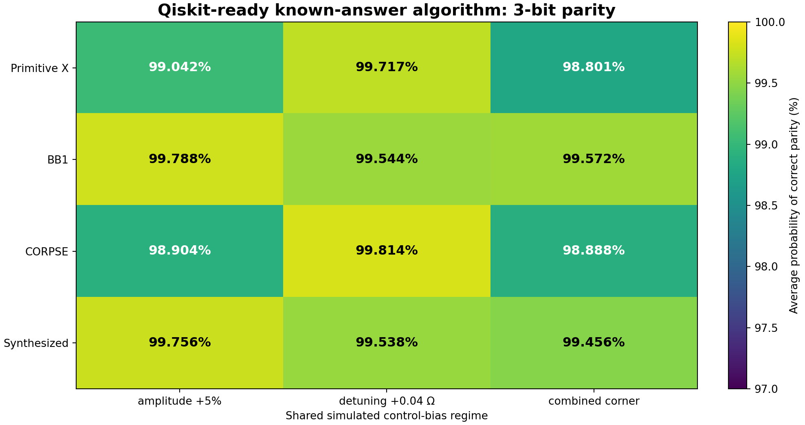

# PulseWise figure guide

This guide maps each important research claim to a specific **committed** figure or data artifact. The PNGs are static, generated results, not live hardware measurements. Use the full-size images when presenting; avoid screen-recording the whole Streamlit page zoomed far out.

## Recommended viewing order

### 1. Why reliability depends on circuit depth

[Open at full size](../results/option_b/01_known_answer_depth.png) · [Reproduce via `src/build_option_b.py`](../src/build_option_b.py)

**What it shows:** Correct-output probability in a known-answer repeated-X circuit, including the frozen combined-error case. The relevant `X^32` headline is BB1 **95.57%** versus synthesized **4.32%**. The horizontal axis is *circuit depth*, not time. All results are model-based.

### 2. What the optimized control looks like

[Open at full size](../results/research/synthesized_waveform.png) · [Numerical report](../results/research/optimization_report.json)

**What it shows:** Five piecewise-rectangular controls with phase/rotation-angle changes. At the fixed drive assumption, the saved synthesized pulse lasts **345.68 ns** versus **500 ns** for BB1. The optimizer targeted sampled single-gate average fidelity, not circuit correctness.

### 3. Speed versus sampled robustness

[Open at full size](../results/research/synthesis_speed_robustness.png) · [Candidate table](../results/research/candidate_comparison.csv)

**What it shows:** The cost of pulse duration versus fidelity under the synthesis model. A 99.7% threshold applies only to the explicitly sampled calibration uncertainty domain.

### 4. Model mismatch: leakage

[Open at full size](../results/option_b/02_matched_multilevel.png) · [Data](../results/option_b/multilevel_comparison.csv)

**What it shows:** A separate coherent four-level surrogate, where Primitive X has **92.32%** unconditional logical fidelity and BB1 **67.24%** in the specified example. **No T1/T2 is included** and the Hamiltonian is **not a calibrated Gridium model**. Do not put this figure on the same fidelity scale as the noisy two-level circuit and imply identical assumptions.

### 5. Stress test outside the training domain

[Open at full size](../results/option_b/03_stress_failure_rate.png) · [Data](../results/option_b/optimizer_stress_test.csv)

**What it shows:** The synthesized design fails the 99.7% target on **18.9%** of sampled cases in a deliberately shifted, out-of-domain uncertainty region. An in-domain sampled minimum is not a proof over every continuous parameter value.

### 6. The price of added control complexity

[Open at full size](../results/option_b/04_circuit_resource_cost.png)

**What it shows:** Cumulative pulse segments and modeled control duration. For the 32-gate test, BB1 takes 16.00 µs / 128 segments; synthesized takes 11.06 µs / 160 segments. Duration and segment count are distinct costs. Neither is a measured hardware runtime.

### 7. Small algorithm demonstration

[Open at full size](../results/option_b/05_parity_algorithm.png) · [Aer results](../results/option_b/qiskit_aer_validation.json)

**What it shows:** Three-bit parity with noisy X preparations but ideal CNOTs, other state preparation, and readout. It is a restricted circuit demonstration, not a fully noisy algorithm.

## Additional archived visualizations

- [Synthesis fidelity landscape](../results/research/synthesis_fidelity_landscape.png)
- [Multilevel leakage parameter sweep](../results/research/multilevel_leakage_stress_test.png)
- [Pulse selection map](../results/selector/pulse_selection_map.png)
- [Coherence crossover](../results/selector/coherence_crossover.png)
- [Fidelity versus duration](../results/selector/fidelity_duration.png)
- [Amplitude and detuning comparisons](../results/decoherence/)

## Recording and interpretation checklist

- Display figure titles, legends, and both axis labels **at readable zoom**. Prefer opening the PNG itself rather than filming a miniature embedded page.
- State whether fidelity means *average single-gate fidelity*, *logical fidelity*, or *known-answer correct-output probability*. They are not interchangeable.
- Distinguish seconds, microseconds, nanoseconds, shots, and dimensionless probabilities.
- Label all results as **simulations**. Qiskit Aer sampling of the same modeled channels is not hardware validation.
- Preserve the frozen benchmark parameters when quoting headline percentages. See [exact numerical findings](../results/option_b/NUMERICAL_FINDINGS.md).
